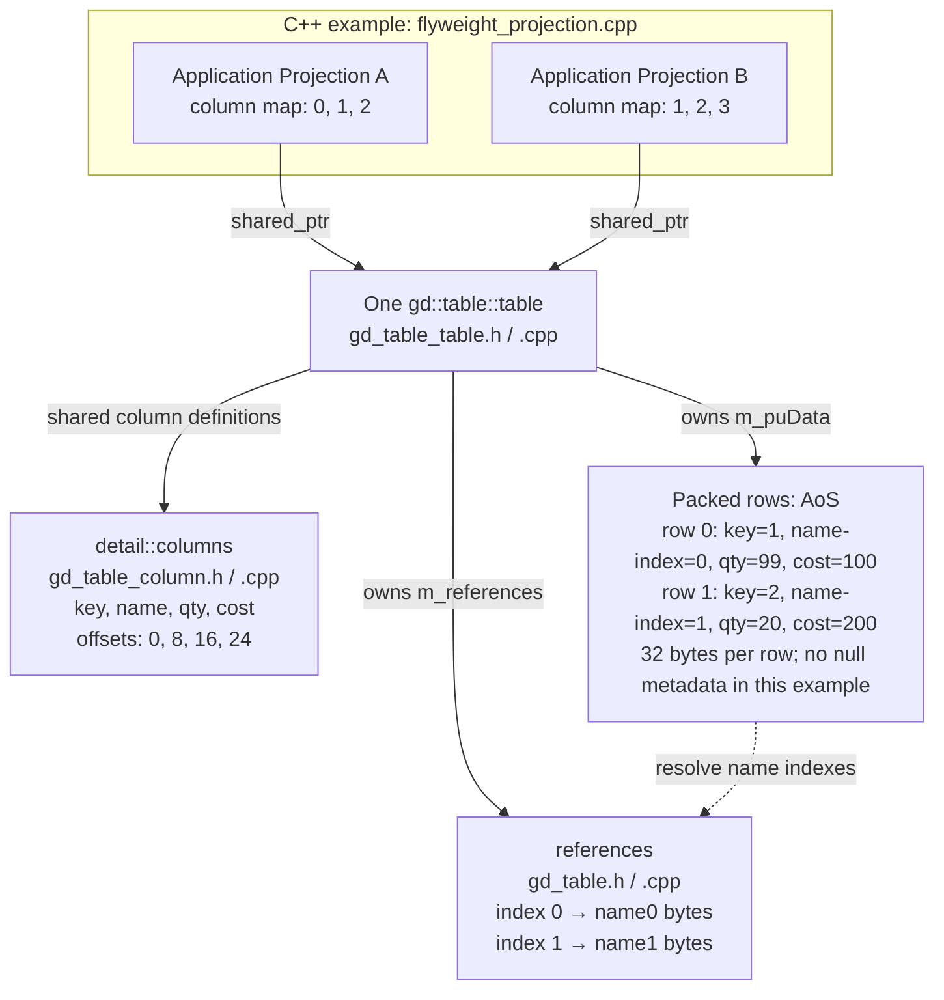
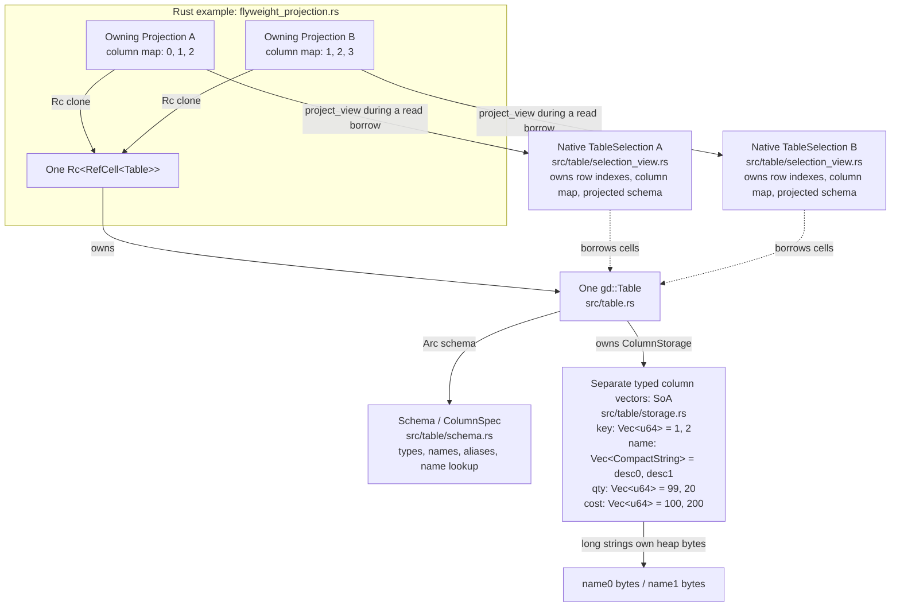

# Shared table storage and column projections

The [C++ example](../cpp-reference/flyweight_projection.cpp) uses the GD member table
`gd::table::table`. The [Rust example](../../examples/flyweight_projection.rs) uses
`gd::Table` and native `TableSelection` views. Both have the same two rows, the same
four columns (`key`, `name`, `qty`, `cost`), and overlapping projections:

- A: `key`, `name`, `qty`;
- B: `name`, `qty`, `cost`.

The Rust fixture builds application-owned handles around borrowed selections.
For the library's owning immutable selections and synchronized mutable
projections, see the [table API guide](../../docs/api/tables.md#owning-immutable-selections).

Run both from the repository root:

```sh
python3 benches/projection/verify.py
```

Select one implementation with `--implementation cpp` or `--implementation rust`.
The runner needs a C++20 compiler and Cargo. It builds the unmodified GD submodule
into `target/projection-example` without CMake, SQLite, or Google Benchmark.
The Rust example can also be run directly:

```sh
cargo run --locked --no-default-features --example flyweight_projection
```

The C++ reference is pinned to `cb11cff90d05260a88d59a30c9da421cd4e19c34`.
Its native member table shares `detail::columns`, while each prepared table owns
its own cell allocation. `new_columns_s(source, indexes, count)` copies selected
column definitions; preparing a destination and using mapped `append` copies
the selected values. The example verifies these distinctions through actual
cell addresses and by changing the source after creating the copied projection.
It also tries `table(subset_columns, source_table, first_row, row_count)` in an
isolated process: the pinned GD implementation rejects different source and
destination column counts with an assertion. With the full schema, that
constructor copies the cells rather than sharing their allocation.

Sharing cells through different projections is implemented in the C++ example by
the small application class `Projection`: it holds a `std::shared_ptr` to one GD
member table and a column map. This is an application extension, not a native GD
projection-table constructor. The example does not alias internal GD buffers or
change GD ownership fields.

The Rust owning descriptor holds `Rc<RefCell<Table>>` and a column map. It creates
native `project_view` selections while reading, then releases those borrows before
writing. Both implementations verify that the projections share string bytes,
that changing A's quantity from 10 to 99 is visible in the source and B, that the
materialized copy remains 10, and that dropping the original owning handle keeps
the views valid. The Rust example also reads both projections on separate threads
using `Arc<Table>`.

These examples share cell storage, rather than just schemas. GD's C++ `Projection`
retains only its owner handle and column map. Rust's temporary `project_view`
additionally allocates row positions and a projected schema; no cell payloads are
copied. `Rc<RefCell<Table>>` is used for sequential edits, and `Arc<Table>` for
immutable sharing across threads. Applications can use `SharedTableProjection`
for synchronized writes; this fixture uses sequential `RefCell` access.

The checks are correctness examples, not performance measurements.

## Files and storage in the projection examples

The diagrams show the mutable example after A changes the first row's quantity
to 99. `name0` and `name1` denote the stored Ada and Grace string payloads.



The application projections retain one existing GD table; they are not separate
native GD tables pointing at the same `m_puData` allocation. A second native
member table sharing the `detail::columns` object has its own row buffer.



The Rust selections are released before the example edits the source. The
`Arc<Table>` worker example uses the same SoA storage layout with immutable
ownership across threads. A separate `Table` sharing only `Arc<Schema>` has its
own column vectors.

Verified on 2026-10-13 with Apple Clang 21.0.0 and Rust 1.99.0 on macOS ARM64.
Both examples ran successfully. The isolated GD subset-constructor probe
reached the expected equal-column-count assertion in `append`.
